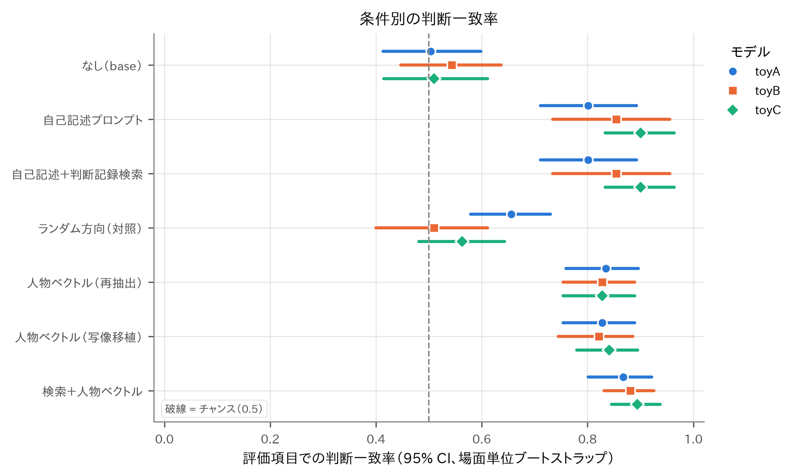
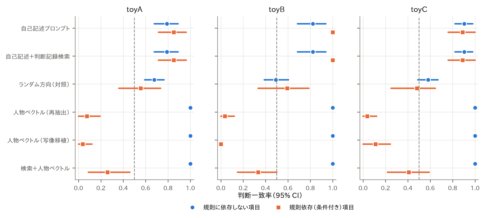
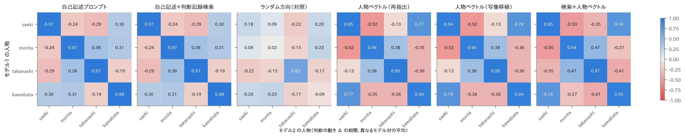
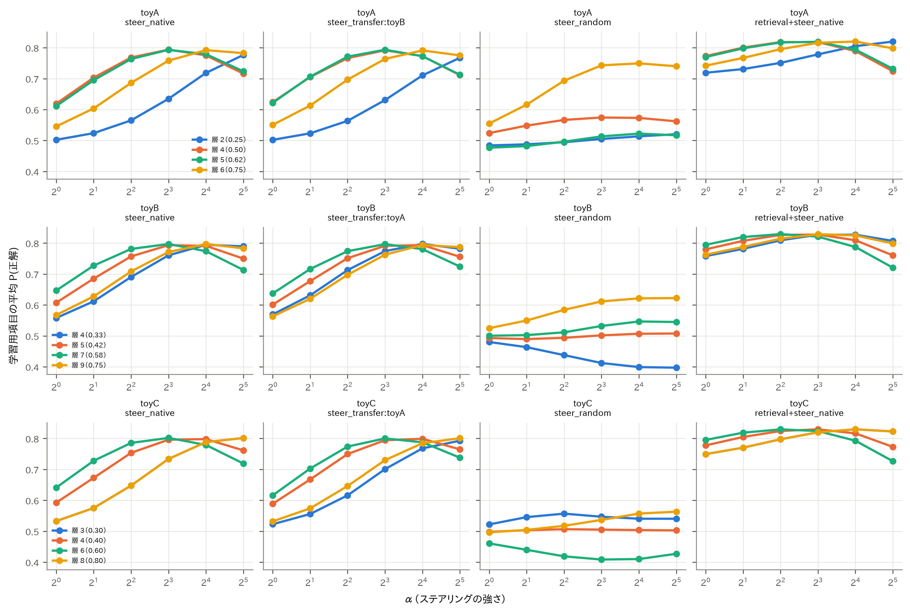

# 疑似人格のモデル間保存：結果報告（toy_pilot（合成モデルによるパイプライン較正））

> **注意：この結果には合成モデル（toy）が含まれる。** 合成モデルは解析パイプラインの較正用で、効果は構成上与えたものである。科学的な知見として解釈してはならない。

- モデル: toyA, toyB, toyC
- 人物: saeki, morita, takanashi, kawabata
- 評価項目数（test）: 39（場面 28）
- 判定基準: `{'min_gain_vs_base': 0.1, 'min_identification': 0.8, 'min_big5_r': 0.6, 'max_ppl_ratio': 1.1, 'min_cross_model_diag_adv': 0.2, 'noninferiority_delta': 0.05}`

## 1. 判断一致率（評価項目）

| モデル | 条件 | 一致率 | 95% CI | 平均P(正解) | ラベル確率 | n | 層 | α |
|---|---|---|---|---|---|---|---|---|
| toyA | なし（base） | 0.503 | [0.413, 0.599] | 0.493 | 1.000 | 151 | — | — |
| toyA | 自己記述プロンプト | 0.801 | [0.711, 0.893] | 0.703 | 1.000 | 151 | — | — |
| toyA | 自己記述＋判断記録検索 | 0.801 | [0.711, 0.893] | 0.703 | 1.000 | 151 | — | — |
| toyA | ランダム方向（対照） | 0.656 | [0.579, 0.730] | 0.632 | 1.000 | 151 | 6.000 | 16.000 |
| toyA | 人物ベクトル（再抽出） | 0.834 | [0.759, 0.896] | 0.749 | 1.000 | 151 | 4.000 | 8.000 |
| toyA | 人物ベクトル（写像移植）（元: toyB） | 0.828 | [0.753, 0.889] | 0.749 | 1.000 | 151 | 5.000 | 8.000 |
| toyA | 検索＋人物ベクトル | 0.868 | [0.801, 0.921] | 0.786 | 1.000 | 151 | 6.000 | 16.000 |
| toyB | なし（base） | 0.543 | [0.447, 0.637] | 0.500 | 1.000 | 151 | — | — |
| toyB | 自己記述プロンプト | 0.854 | [0.734, 0.956] | 0.712 | 1.000 | 151 | — | — |
| toyB | 自己記述＋判断記録検索 | 0.854 | [0.734, 0.956] | 0.712 | 1.000 | 151 | — | — |
| toyB | ランダム方向（対照） | 0.510 | [0.400, 0.611] | 0.507 | 1.000 | 151 | 9.000 | 32.000 |
| toyB | 人物ベクトル（再抽出） | 0.828 | [0.753, 0.889] | 0.753 | 1.000 | 151 | 7.000 | 8.000 |
| toyB | 人物ベクトル（写像移植）（元: toyA） | 0.821 | [0.745, 0.885] | 0.753 | 1.000 | 151 | 4.000 | 16.000 |
| toyB | 検索＋人物ベクトル | 0.881 | [0.831, 0.926] | 0.794 | 1.000 | 151 | 7.000 | 4.000 |
| toyC | なし（base） | 0.510 | [0.414, 0.611] | 0.503 | 1.000 | 151 | — | — |
| toyC | 自己記述プロンプト | 0.901 | [0.833, 0.964] | 0.718 | 1.000 | 151 | — | — |
| toyC | 自己記述＋判断記録検索 | 0.901 | [0.833, 0.964] | 0.718 | 1.000 | 151 | — | — |
| toyC | ランダム方向（対照） | 0.563 | [0.481, 0.643] | 0.546 | 1.000 | 151 | 8.000 | 32.000 |
| toyC | 人物ベクトル（再抽出） | 0.828 | [0.753, 0.889] | 0.757 | 1.000 | 151 | 6.000 | 8.000 |
| toyC | 人物ベクトル（写像移植）（元: toyA） | 0.841 | [0.779, 0.895] | 0.757 | 1.000 | 151 | 8.000 | 32.000 |
| toyC | 検索＋人物ベクトル | 0.894 | [0.845, 0.937] | 0.802 | 1.000 | 151 | 8.000 | 16.000 |

「ラベル確率」は次のトークンが A か B である確率の合計（回答形式に従っているかの診断）。0.5 を大きく下回る条件は、人格ではなく形式で失敗している可能性があるため解釈に注意。

## 2. 事前登録した仮説の検定

H1: テキスト条件は base より一致率が高い／H2a: 写像移植ベクトル > ランダム方向／H2b: 写像移植は再抽出に対して非劣性（δ）／H3a: 検索＋人物ベクトル > 検索のみ／H3b: 人物ベクトル vs 検索（両側・探索的）／H4: 規則依存項目でステアリングの不利が大きい。p は場面単位の符号反転並べ替え（H4 はブートストラップ）、p_holm は確認的検定全体での Holm 補正。

| 仮説 | モデル | 比較 | 差 | CI下 | CI上 | p | p_holm | 非劣性 | n |
|---|---|---|---|---|---|---|---|---|---|
| H1 | toyA | prompt > base | 0.298 | 0.212 | 0.395 | 0.000 | 0.003 | — | 151 |
| H1 | toyA | retrieval > base | 0.298 | 0.212 | 0.395 | 0.000 | 0.003 | — | 151 |
| H2a | toyA | steer_transfer:toyB > steer_random | 0.172 | 0.071 | 0.272 | 0.003 | 0.013 | — | 151 |
| H2b | toyA | steer_transfer:toyB ≥ steer_native − δ | -0.007 | -0.022 | 0.000 | 1.000 | — | ○ | 151 |
| H3a | toyA | retrieval+steer_native > retrieval | 0.066 | -0.064 | 0.190 | 0.193 | 0.579 | — | 151 |
| H3b | toyA | steer_native vs retrieval | 0.033 | -0.102 | 0.165 | 0.712 | — | — | 151 |
| H4 | toyA | (retrieval − steer_native) is larger on rule-dependent items | 0.987 | 0.815 | 1.147 | 0.000 | 0.003 | — | 151 |
| H1 | toyB | prompt > base | 0.311 | 0.227 | 0.399 | 0.000 | 0.003 | — | 151 |
| H1 | toyB | retrieval > base | 0.311 | 0.227 | 0.399 | 0.000 | 0.003 | — | 151 |
| H2a | toyB | steer_transfer:toyA > steer_random | 0.311 | 0.185 | 0.430 | 0.000 | 0.003 | — | 151 |
| H2b | toyB | steer_transfer:toyA ≥ steer_native − δ | -0.007 | -0.022 | 0.000 | 1.000 | — | ○ | 151 |
| H3a | toyB | retrieval+steer_native > retrieval | 0.026 | -0.106 | 0.174 | 0.396 | 0.791 | — | 151 |
| H3b | toyB | steer_native vs retrieval | -0.026 | -0.171 | 0.123 | 0.797 | — | — | 151 |
| H4 | toyB | (retrieval − steer_native) is larger on rule-dependent items | 1.140 | 0.990 | 1.293 | 0.000 | 0.003 | — | 151 |
| H1 | toyC | prompt > base | 0.391 | 0.306 | 0.489 | 0.000 | 0.003 | — | 151 |
| H1 | toyC | retrieval > base | 0.391 | 0.306 | 0.489 | 0.000 | 0.003 | — | 151 |
| H2a | toyC | steer_transfer:toyA > steer_random | 0.278 | 0.183 | 0.364 | 0.000 | 0.003 | — | 151 |
| H2b | toyC | steer_transfer:toyA ≥ steer_native − δ | 0.013 | 0.000 | 0.043 | 1.000 | — | ○ | 151 |
| H3a | toyC | retrieval+steer_native > retrieval | -0.007 | -0.089 | 0.080 | 0.615 | 0.791 | — | 151 |
| H3b | toyC | steer_native vs retrieval | -0.073 | -0.175 | 0.025 | 0.214 | — | — | 151 |
| H4 | toyC | (retrieval − steer_native) is larger on rule-dependent items | 0.949 | 0.798 | 1.089 | 0.000 | 0.003 | — | 151 |

## 3. 条件付き判断（規則依存項目）

| モデル | 条件 | 規則依存 | 一致率 | CI下 | CI上 | n |
|---|---|---|---|---|---|---|
| toyA | base | ○ | 0.481 | 0.308 | 0.696 | 27 |
| toyA | base | × | 0.508 | 0.413 | 0.612 | 124 |
| toyA | prompt | ○ | 0.852 | 0.714 | 0.963 | 27 |
| toyA | prompt | × | 0.790 | 0.677 | 0.891 | 124 |
| toyA | retrieval | ○ | 0.852 | 0.714 | 0.963 | 27 |
| toyA | retrieval | × | 0.790 | 0.677 | 0.891 | 124 |
| toyB | base | ○ | 0.704 | 0.517 | 0.870 | 27 |
| toyB | base | × | 0.508 | 0.405 | 0.611 | 124 |
| toyB | prompt | ○ | 1.000 | 1.000 | 1.000 | 27 |
| toyB | prompt | × | 0.823 | 0.686 | 0.939 | 124 |
| toyB | retrieval | ○ | 1.000 | 1.000 | 1.000 | 27 |
| toyB | retrieval | × | 0.823 | 0.686 | 0.939 | 124 |
| toyC | base | ○ | 0.593 | 0.375 | 0.750 | 27 |
| toyC | base | × | 0.492 | 0.390 | 0.596 | 124 |
| toyC | prompt | ○ | 0.889 | 0.760 | 1.000 | 27 |
| toyC | prompt | × | 0.903 | 0.822 | 0.979 | 124 |
| toyC | retrieval | ○ | 0.889 | 0.760 | 1.000 | 27 |
| toyC | retrieval | × | 0.903 | 0.822 | 0.979 | 124 |
| toyA | steer_native | ○ | 0.074 | 0.000 | 0.192 | 27 |
| toyA | steer_native | × | 1.000 | 1.000 | 1.000 | 124 |
| toyA | steer_transfer:toyB | ○ | 0.037 | 0.000 | 0.120 | 27 |
| toyA | steer_transfer:toyB | × | 1.000 | 1.000 | 1.000 | 124 |
| toyA | steer_random | ○ | 0.556 | 0.360 | 0.733 | 27 |
| toyA | steer_random | × | 0.677 | 0.592 | 0.763 | 124 |
| toyA | retrieval+steer_native | ○ | 0.259 | 0.087 | 0.458 | 27 |
| toyA | retrieval+steer_native | × | 1.000 | 1.000 | 1.000 | 124 |
| toyB | steer_native | ○ | 0.037 | 0.000 | 0.120 | 27 |
| toyB | steer_native | × | 1.000 | 1.000 | 1.000 | 124 |
| toyB | steer_transfer:toyA | ○ | 0.000 | 0.000 | 0.000 | 27 |
| toyB | steer_transfer:toyA | × | 1.000 | 1.000 | 1.000 | 124 |
| toyB | steer_random | ○ | 0.593 | 0.333 | 0.788 | 27 |
| toyB | steer_random | × | 0.492 | 0.389 | 0.605 | 124 |
| toyB | retrieval+steer_native | ○ | 0.333 | 0.150 | 0.500 | 27 |
| toyB | retrieval+steer_native | × | 1.000 | 1.000 | 1.000 | 124 |
| toyC | steer_native | ○ | 0.037 | 0.000 | 0.120 | 27 |
| toyC | steer_native | × | 1.000 | 1.000 | 1.000 | 124 |
| toyC | steer_transfer:toyA | ○ | 0.111 | 0.000 | 0.243 | 27 |
| toyC | steer_transfer:toyA | × | 1.000 | 1.000 | 1.000 | 124 |
| toyC | steer_random | ○ | 0.481 | 0.250 | 0.645 | 27 |
| toyC | steer_random | × | 0.581 | 0.488 | 0.670 | 124 |
| toyC | retrieval+steer_native | ○ | 0.407 | 0.217 | 0.591 | 27 |
| toyC | retrieval+steer_native | × | 1.000 | 1.000 | 1.000 | 124 |

## 4. モデルをまたいだ人物の同一性

各モデルで「人物を与えたことによる判断の動き」Δ = P(B|条件) − P(B|base) を求め、異なるモデルの間で人物どうしの相関をとった。対角（同じ人物）が非対角より高いほど、人格がモデルをまたいで同じ形で保たれている。

| 条件 | モデル | 対角平均 | 対角の優位 | CI下 | CI上 |
|---|---|---|---|---|---|
| prompt | toyA,toyB,toyC | 0.971 | 0.926 | 0.764 | 1.054 |
| retrieval | toyA,toyB,toyC | 0.971 | 0.926 | 0.764 | 1.054 |
| steer_native | toyA,toyB,toyC | 0.946 | 0.980 | 0.812 | 1.125 |
| steer_transfer | toyA,toyB,toyC | 0.945 | 0.979 | 0.809 | 1.127 |
| steer_random | toyA,toyB,toyC | 0.185 | 0.188 | 0.075 | 0.309 |
| retrieval+steer_native | toyA,toyB,toyC | 0.951 | 1.003 | 0.843 | 1.137 |

### 人物識別率（4人から最尤で当てる。チャンス = 0.25）

| モデル | 条件 | 5項目 | 10項目 | 20項目 |
|---|---|---|---|---|
| toyA | prompt | 0.747 | 0.934 | 0.998 |
| toyA | retrieval | 0.766 | 0.938 | 0.997 |
| toyA | retrieval+steer_native | 0.674 | 0.727 | 0.791 |
| toyA | steer_native | 0.620 | 0.665 | 0.685 |
| toyA | steer_random | 0.472 | 0.551 | 0.642 |
| toyA | steer_transfer:toyB | 0.635 | 0.666 | 0.691 |
| toyB | prompt | 0.758 | 0.913 | 0.970 |
| toyB | retrieval | 0.752 | 0.911 | 0.977 |
| toyB | retrieval+steer_native | 0.705 | 0.764 | 0.861 |
| toyB | steer_native | 0.607 | 0.677 | 0.700 |
| toyB | steer_random | 0.232 | 0.182 | 0.125 |
| toyB | steer_transfer:toyA | 0.627 | 0.673 | 0.687 |
| toyC | prompt | 0.785 | 0.941 | 0.999 |
| toyC | retrieval | 0.802 | 0.956 | 0.998 |
| toyC | retrieval+steer_native | 0.719 | 0.766 | 0.863 |
| toyC | steer_native | 0.610 | 0.677 | 0.722 |
| toyC | steer_random | 0.204 | 0.163 | 0.127 |
| toyC | steer_transfer:toyA | 0.626 | 0.678 | 0.707 |

## 5. Big Five プロフィール

| モデル | 条件 | 目標との相関(平均) | 平均絶対誤差 |
|---|---|---|---|
| toyA | base | 0.496 | 0.917 |
| toyA | prompt | 0.986 | 0.172 |
| toyA | retrieval | 0.986 | 0.172 |
| toyA | retrieval+steer_native | 0.986 | 0.172 |
| toyA | steer_native | 0.496 | 0.917 |
| toyA | steer_random | 0.496 | 0.917 |
| toyA | steer_transfer:toyB | 0.496 | 0.917 |
| toyB | base | 0.325 | 0.932 |
| toyB | prompt | 0.987 | 0.156 |
| toyB | retrieval | 0.987 | 0.156 |
| toyB | retrieval+steer_native | 0.987 | 0.156 |
| toyB | steer_native | 0.325 | 0.932 |
| toyB | steer_random | 0.325 | 0.932 |
| toyB | steer_transfer:toyA | 0.325 | 0.932 |
| toyC | base | -0.261 | 1.045 |
| toyC | prompt | 0.992 | 0.243 |
| toyC | retrieval | 0.992 | 0.243 |
| toyC | retrieval+steer_native | 0.992 | 0.243 |
| toyC | steer_native | -0.261 | 1.045 |
| toyC | steer_random | -0.261 | 1.045 |
| toyC | steer_transfer:toyA | -0.261 | 1.045 |

## 6. ステアリングの信頼性と能力保持

| モデル | 条件 | 正解方向への平均移動 | 正解方向に動いた割合 | 逆方向に動いた割合 | 移動のSD |
|---|---|---|---|---|---|
| toyA | steer_native | 0.257 | 0.821 | 0.166 | 0.326 |
| toyA | steer_transfer:toyB | 0.257 | 0.821 | 0.166 | 0.326 |
| toyA | steer_random | 0.139 | 0.682 | 0.291 | 0.418 |
| toyA | retrieval+steer_native | 0.294 | 0.868 | 0.126 | 0.311 |
| toyB | steer_native | 0.253 | 0.821 | 0.172 | 0.335 |
| toyB | steer_transfer:toyA | 0.254 | 0.821 | 0.179 | 0.337 |
| toyB | steer_random | 0.007 | 0.517 | 0.457 | 0.425 |
| toyB | retrieval+steer_native | 0.295 | 0.894 | 0.106 | 0.298 |
| toyC | steer_native | 0.254 | 0.821 | 0.172 | 0.329 |
| toyC | steer_transfer:toyA | 0.254 | 0.821 | 0.172 | 0.329 |
| toyC | steer_random | 0.043 | 0.570 | 0.417 | 0.451 |
| toyC | retrieval+steer_native | 0.299 | 0.894 | 0.106 | 0.292 |

| モデル | 条件 | NLL(base) | NLL | パープレキシティ比 |
|---|---|---|---|---|
| toyA | steer_native | 2.000 | 2.986 | 2.680 |
| toyA | steer_transfer:toyB | 2.000 | 2.942 | 2.565 |
| toyA | steer_random | 2.000 | 4.008 | 7.448 |
| toyA | retrieval+steer_native | 2.000 | 4.008 | 7.448 |
| toyB | steer_native | 2.000 | 3.441 | 4.225 |
| toyB | steer_transfer:toyA | 2.000 | 7.094 | 162.962 |
| toyB | steer_random | 2.000 | 17.219 | 4068517.031 |
| toyB | retrieval+steer_native | 2.000 | 2.360 | 1.434 |
| toyC | steer_native | 2.000 | 2.896 | 2.450 |
| toyC | steer_transfer:toyA | 2.000 | 7.800 | 330.458 |
| toyC | steer_random | 2.000 | 8.348 | 571.216 |
| toyC | retrieval+steer_native | 2.000 | 3.587 | 4.889 |

### 写像の診断（移植ベクトルと再抽出ベクトルのコサイン類似度、全層・全人物の平均）

| 移植先 | 元 | cos | cos(ランダム) | 写像CV R² |
|---|---|---|---|---|
| toyA | toyB | 1.000 | -0.108 | 1.000 |
| toyB | toyA | 1.000 | 0.000 | 0.998 |
| toyC | toyA | 1.000 | -0.041 | 0.998 |

### 調整曲線

> **調整の警告：** 選ばれた値が探索格子の端にある。格子を広げて再実行するまで、その条件の効果は過小評価の可能性がある。

- toyA / steer_random: 層 6 が候補の端
- toyA / retrieval+steer_native: 層 6 が候補の端
- toyB / steer_transfer:toyA: 層 4 が候補の端
- toyB / steer_random: α=32 が格子の端（1〜32）
- toyB / steer_random: 層 9 が候補の端
- toyC / steer_transfer:toyA: α=32 が格子の端（1〜32）
- toyC / steer_transfer:toyA: 層 8 が候補の端
- toyC / steer_random: α=32 が格子の端（1〜32）
- toyC / steer_random: 層 8 が候補の端
- toyC / retrieval+steer_native: 層 8 が候補の端

## 7. 判定（事前登録の基準）

| モデル | 条件 | 上積み | 上積みCI下 | 識別@20 | Big5 r | PPL比 | モデル間優位 | 保存 |
|---|---|---|---|---|---|---|---|---|
| toyA | prompt | 0.298 | 0.212 | 0.998 | 0.986 | — | 0.926 | ○ |
| toyA | retrieval | 0.298 | 0.212 | 0.997 | 0.986 | — | 0.926 | ○ |
| toyA | steer_random | 0.152 | 0.025 | 0.642 | 0.496 | 7.448 | 0.188 | × |
| toyA | steer_native | 0.331 | 0.208 | 0.685 | 0.496 | 2.680 | 0.980 | × |
| toyA | steer_transfer:toyB | 0.325 | 0.203 | 0.691 | 0.496 | 2.565 | 0.979 | × |
| toyA | retrieval+steer_native | 0.364 | 0.252 | 0.791 | 0.986 | 7.448 | 1.003 | × |
| toyB | prompt | 0.311 | 0.227 | 0.970 | 0.987 | — | 0.926 | ○ |
| toyB | retrieval | 0.311 | 0.227 | 0.977 | 0.987 | — | 0.926 | ○ |
| toyB | steer_random | -0.033 | -0.151 | 0.125 | 0.325 | 4068517.031 | 0.188 | × |
| toyB | steer_native | 0.285 | 0.155 | 0.700 | 0.325 | 4.225 | 0.980 | × |
| toyB | steer_transfer:toyA | 0.278 | 0.146 | 0.687 | 0.325 | 162.962 | 0.979 | × |
| toyB | retrieval+steer_native | 0.338 | 0.219 | 0.861 | 0.987 | 1.434 | 1.003 | × |
| toyC | prompt | 0.391 | 0.306 | 0.999 | 0.992 | — | 0.926 | ○ |
| toyC | retrieval | 0.391 | 0.306 | 0.998 | 0.992 | — | 0.926 | ○ |
| toyC | steer_random | 0.053 | -0.084 | 0.127 | -0.261 | 571.216 | 0.188 | × |
| toyC | steer_native | 0.318 | 0.193 | 0.722 | -0.261 | 2.450 | 0.980 | × |
| toyC | steer_transfer:toyA | 0.331 | 0.221 | 0.707 | -0.261 | 330.458 | 0.979 | × |
| toyC | retrieval+steer_native | 0.384 | 0.288 | 0.863 | 0.992 | 4.889 | 1.003 | × |

「保存」は、その条件で測れた基準（上積み・識別・Big Five・PPL・モデル間優位）をすべて満たした場合のみ ○。テキストのみの API モデルでは PPL は測れないので、その項目は判定から除く。
